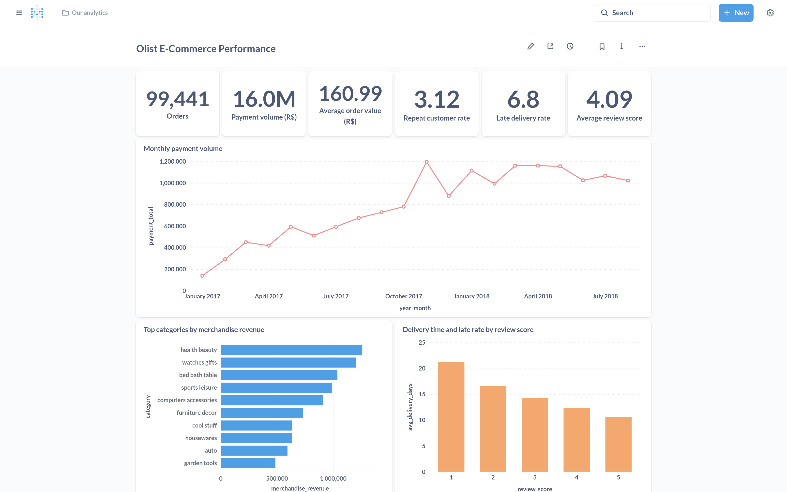
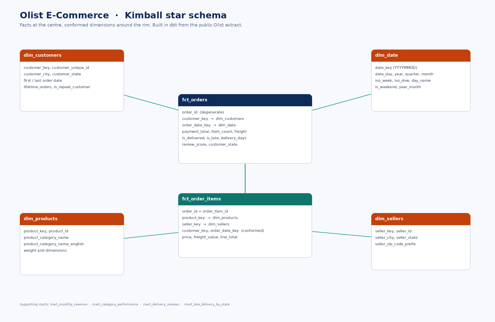
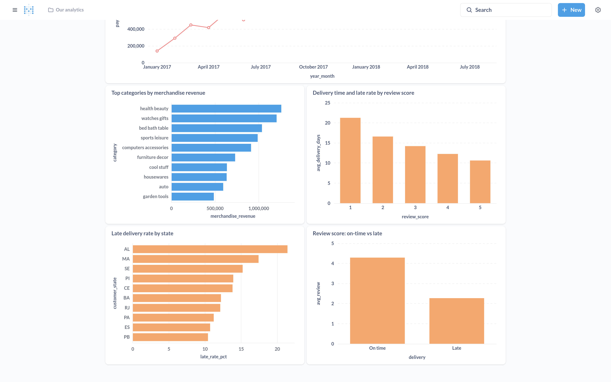
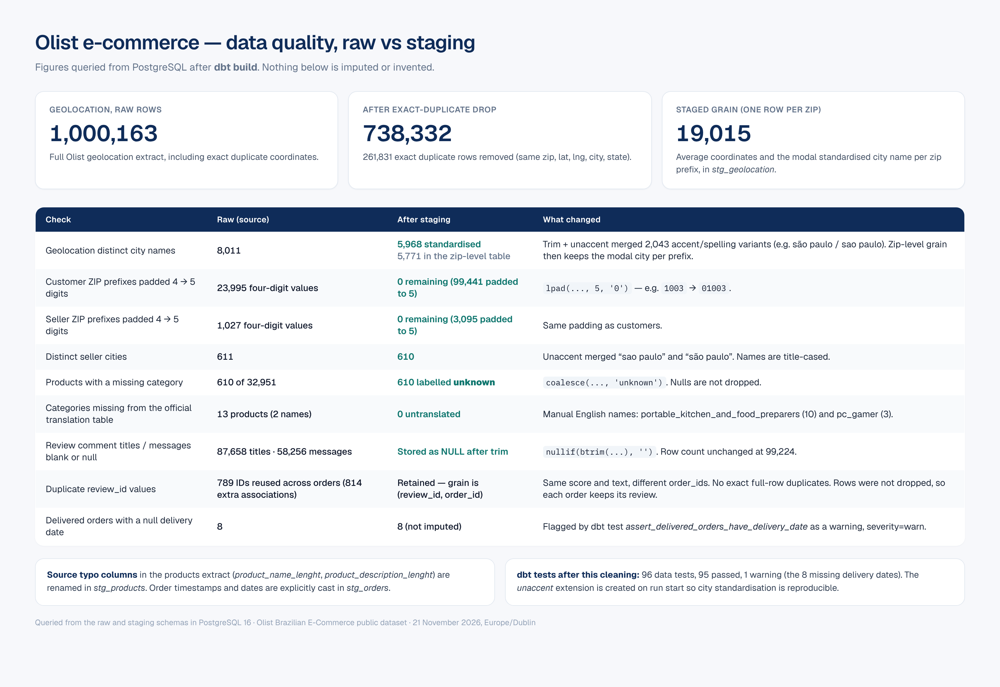
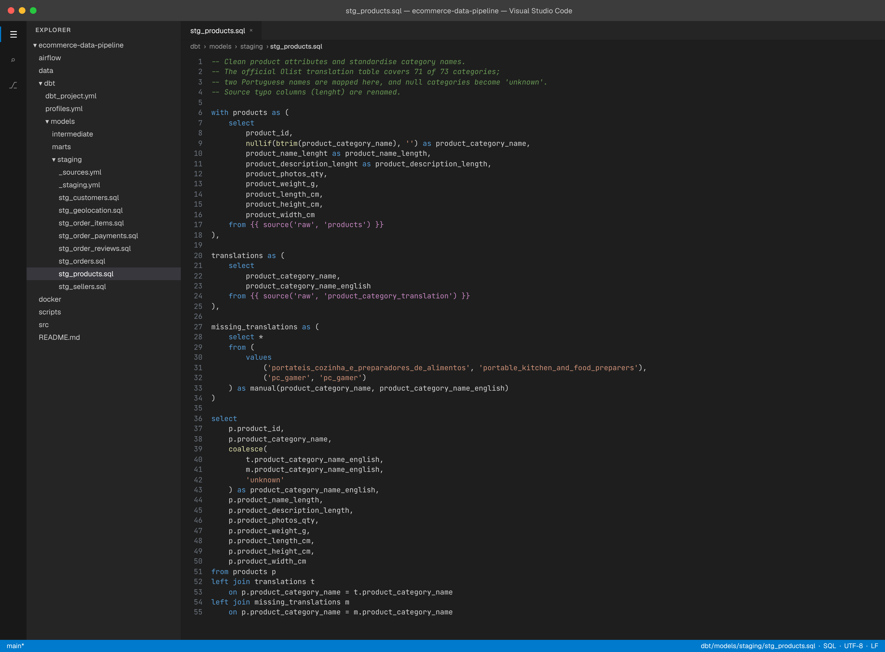
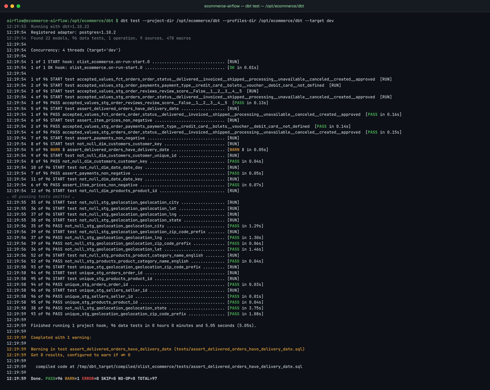
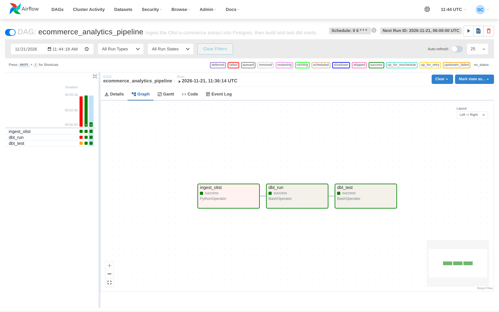

# E-Commerce Data Pipeline

End-to-end analytics pipeline on the public [Olist Brazilian e-commerce](https://www.kaggle.com/datasets/olistbr/brazilian-ecommerce) dataset (~99k orders, 2016–2018).

Python loads the CSVs into PostgreSQL, dbt models a star schema with tests, Airflow runs the daily job, and Metabase shows the dashboard. Everything starts with Docker Compose.



## What it does

```text
Olist CSVs  →  Python ingest  →  Postgres (raw)
                                      ↓
                              dbt staging → intermediate → marts
                                      ↓
                         Airflow: ingest → deps → run → test
                                      ↓
                                   Metabase
```

| Layer | Tool | Notes |
| --- | --- | --- |
| Ingest | Python + `COPY` | Nine tables into `raw` |
| Transform | dbt-postgres | Staging, intermediate, marts |
| Orchestration | Airflow 2.10 | Daily at 06:00 |
| BI | Metabase | KPI dashboard |
| Infra | Docker Compose | Postgres + Airflow + Metabase |

Data model: `fct_orders`, `fct_order_items`, plus `dim_customers`, `dim_products`, `dim_sellers`, `dim_date`. Reporting marts feed the dashboard (`mart_monthly_revenue`, `mart_category_performance`, `mart_delivery_reviews`, `mart_late_delivery_by_state`).



## Main finding

Late deliveries are only **6.8%** of delivered orders, but they pull the average review score from **4.29 → 2.27**. Delivery speed shows up more clearly in satisfaction than anything else I looked at.

A few other numbers from the marts:

- Payment volume **R$ 16.0M**, AOV **R$ 160.99**, average review **4.09**
- Repeat customers: **3.12%** (2,997 of 96,096)
- Black Friday peak: Nov 2017, **R$ 1.19M**
- Highest late rates among larger states: AL **21.4%**, MA **17.4%**, RJ **12.1%**; SP is **4.5%**



## Data cleaning (what actually changed)

I kept dirty business facts and fixed naming / grain issues in staging instead of imputing:

- Geolocation: dropped 261k exact duplicate rows, then rolled up to 19,015 zip prefixes
- ZIP codes left-padded to 5 digits; city names unaccented / title-cased
- Product `lenght` typos renamed; missing categories → `unknown`
- Reviews kept at `(review_id, order_id)` because some `review_id`s repeat across orders
- **8 orders** marked delivered with a null delivery date — left as-is and flagged by a dbt warning (not “fixed”)

Data quality report (before vs after cleaning):



Cleaning logic in the dbt staging models:



## Tests

About 96 dbt tests (`unique`, `not_null`, `relationships`, `accepted_values`, plus a few singular SQL checks). Last run: **95 passed, 1 warning** (those eight missing delivery dates).





## Run it locally

Needs Docker.

```bash
cp .env.example .env
./scripts/download_data.sh   # public Olist mirror, no Kaggle login
docker compose up --build
```

| Service | URL | Login |
| --- | --- | --- |
| Airflow | http://localhost:8080 | see `.env` |
| Metabase | http://localhost:3000 | created by setup script |
| Postgres | localhost:5432 | see `.env` |

Trigger the DAG `ecommerce_analytics_pipeline` once it appears (tasks: `ingest_olist` → `dbt_deps` → `dbt_run` → `dbt_test`). After a green run:

```bash
python3 scripts/setup_metabase.py
```


Sample SQL lives in [`analytics/sample_queries.sql`](analytics/sample_queries.sql).

## Project layout

```text
airflow/dags/     DAG definition
analytics/        sample SQL against marts
data/raw/         CSVs (gitignored; download script fills this)
dbt/              models, tests, packages
docker/           Postgres init + Airflow image
scripts/          download, Metabase setup, screenshot helpers
src/ingest.py     CSV → raw schema
screenshots/      dashboard / DAG / lineage captures
tests/            Python unit tests for ingest
```

## Notes

- Credentials in `.env.example` are local demos only.
- Dataset licence is [CC BY-NC-SA 4.0](https://creativecommons.org/licenses/by-nc-sa/4.0/) — attribute Olist; don’t use commercially. CSVs are not committed here.
- Extract source: [olist/work-at-olist-data](https://github.com/olist/work-at-olist-data/tree/master/datasets) (same data as the Kaggle publish).

## License

Code is MIT (see [`LICENSE`](LICENSE)). The Olist dataset remains under its own CC BY-NC-SA terms.
